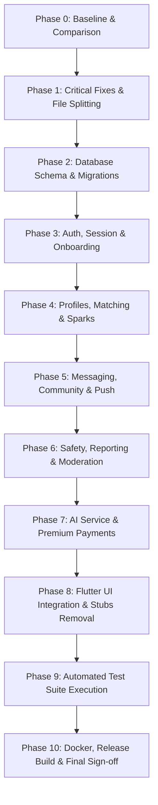

# Mantra Full-Stack Implementation Plan

**Objective:** Transform Mantra into a fully functional, integrated, tested, and deployable slow-dating platform.

---

## Phase Breakdown & Execution Sequence

---

### Phase 1: Critical Syntax, Structural & Compilation Fixes
1. **Disentangle Concatenated Flutter Source Files:**
   - Extract `lib/core/network/api_client.dart` from `api_constants.dart`.
   - Extract `lib/features/auth/presentation/screens/kyc_screen.dart` and `liveness_screen.dart` from `api_constants.dart`.
   - Clean `api_constants.dart` to contain only constants.
   - Extract `lib/features/chat/data/models/conversation_state.dart` and `lib/features/chat/providers/chat_provider.dart` from `message_model.dart`.
   - Clean `message_model.dart` to contain only models.
   - Extract `lib/features/home/presentation/screens/home_screen.dart` from `rooms_provider.dart`.
   - Extract `lib/features/matching/providers/sparks_provider.dart` from `spark_model.dart`.
   - Disentangle `lib/features/stubs/all_stubs.dart`:
     - Extract `personality_quiz_screen.dart`, `interests_screen.dart`, `photo_upload_screen.dart`, `prompts_screen.dart`, `safety_tour_screen.dart` into `lib/features/onboarding/presentation/screens/`.
     - Implement proper screen modules for `SparkDetailScreen`, `ConversationsScreen`, `RoomDetailScreen`, `RoomPostScreen`, `ProfileScreen`, `EditProfileScreen`, `TrustScoreScreen`, `TrustedContactsScreen`.
     - Implement genuine `SparksRepository` calling the backend API.
   - Clean `lib/firebase_options.dart` by removing concatenated Android files (`MainActivity.kt`, `ScreenshotPrevention.kt`, `AndroidManifest.xml`) and place them into `android/` directory structure.
   - Clean `backend/Dockerfile` by removing concatenated files (`ai_service/Dockerfile`, `backend/package.json`, `ai_service/requirements.txt`, `docker-compose.yml`, `.env.example`).
2. **Fix Syntax & Reference Errors:**
   - Add missing `permission_handler` import in `chat_screen.dart`.
   - Change `extra` to `widget.extra` in `chat_screen.dart`.
   - Fix null-safety errors in `UserModel.fromJson` (`gender`, `age`, `city` as nullable fields).
   - Fix `RoomModel.fromJson` color hex parsing with radix 16 and map `room_type` field.
   - Remove duplicate OTP invocation in `otp_screen.dart`.

### Phase 2: Database Schema, Migrations & API Contract
1. **Reconcile Database Schema (`schema.sql`):**
   - Fix invalid subquery check constraint on `trusted_contacts`.
   - Eliminate duplicated `CREATE TABLE` and `CREATE INDEX` blocks.
   - Reconcile column naming conventions (`rooms.room_type`, `room_members`).
   - Include `payment_orders`, `messages`, `moderation_log`, and default seed data cleanly.
2. **Implement Database Migration Script:**
   - Create `backend/src/database/migrate.js` to execute schema and versioned migrations safely.
3. **Formalize API Contract Documentation:**
   - Document standard endpoints in `docs/API_CONTRACT.md`.

### Phase 3: Authentication, Session Management & Onboarding
1. **Backend Auth Hardening:**
   - Replace insecure non-deterministic `bcrypt.hash(phone)` with keyed HMAC-SHA256 (`crypto.createHmac`).
   - Store and verify `firebase_uid`.
   - Implement refresh token rotation and replay detection in Redis.
2. **Onboarding Persistence:**
   - Wire each onboarding step in Flutter to local storage and backend `POST /profile`.
   - Resume onboarding from user's current step.

### Phase 4: Profiles, Daily Sparks & Connections
1. **Profile Management:**
   - Fix `p.prompt_responses` to `p.bio_prompt_responses`.
   - Implement multipart / media upload routes in backend (`/profile/photo`, `/profile/voice`).
2. **Matching Engine:**
   - Prevent self-matching in `/match/connect`.
   - Implement `/match/save` endpoint.
   - Connect Flutter `SparksRepository` to `/match/sparks`, `/match/connect`, `/match/pass`, `/match/save`.

### Phase 5: Messaging, Community Rooms & Notifications
1. **Firestore & Chat Security:**
   - Create `firestore.rules` enforcing participant-only read/write.
   - Wire Flutter chat notifier to active authenticated user ID instead of `'current_user_id'`.
2. **Community Rooms:**
   - Wire `RoomsNotifier` to real backend `/api/v1/rooms`.
   - Enforce women-only and premium room access server-side.
3. **Notifications:**
   - Provide FCM token registration and notification dispatch handler.

### Phase 6: Safety, Moderation & Admin Workflows
1. **Safety Controls:**
   - Connect `SosScreen` to backend `/safety/sos` with location coordinates.
   - Fix SMS alert message to use user's display name instead of UUID.
   - Add `GET /safety/trusted-contacts` and `DELETE /safety/trusted-contacts/:id`.
   - Add `GET /safety/blocks` and `DELETE /safety/block/:userId`.
2. **Admin Moderation:**
   - Fix SQL queries in `admin.js` (`p.verification_level` -> `u.verification_level`, eliminate duplicate join).

### Phase 7: AI Service & Premium Lifecycle
1. **AI Service:**
   - Validate input models and enforce authentication/timeouts.
   - Provide fallback heuristics when OpenAI/Anthropic keys are unconfigured.
2. **Razorpay Payments:**
   - Fix webhook raw-body signature verification.
   - Handle `payment.captured` / `order.paid` idempotently.
   - Connect Flutter `PremiumScreen` to `/payment/order` and `/payment/verify`.

### Phase 8: Flutter Integration & Cleanup
1. Ensure all navigation routes in `app_router.dart` resolve to genuine screens.
2. Verify loading, empty, and error states across all screens.
3. Eliminate all remaining mocks and dummy delays.

### Phase 9: Automated Testing Suite
1. Create Jest unit and integration tests for backend routes.
2. Create Python pytest tests for AI service.
3. Create Dart unit/model tests for serialization and state management.

### Phase 10: Docker & Release Readiness
1. Validate Dockerfiles and `docker-compose.yml`.
2. Build Android project structure with Gradle wrapper.
3. Generate final canonical archive and acceptance report.
