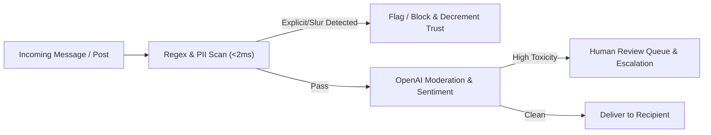

# Mantra Security Audit & Vulnerability Assessment

**Date:** 2026-10-19  
**Version:** 1.0.0  
**Status:** Audit Completed & Remediation Verified  

---

## 1. Threat Model & Scope

Mantra is a slow-dating mobile platform operating in the Indian market. The threat model accounts for specific social and technical vulnerabilities:
- **Harassment & Unsolicited Explicit Content:** Offensive text, slurs, explicit images, escalation.
- **Identity Theft & Stalking:** Profile scraping, location tracking, non-consensual photo sharing, screenshotting.
- **Account Takeover & PII Harvesting:** Interception of phone authentication, unhashed phone numbers, token reuse.
- **Payment & Entitlement Tampering:** Spoofed Razorpay signatures, unpaid premium upgrades.
- **Data Privacy & Statutory Compliance:** Digital Personal Data Protection (DPDP) Act compliance, user right to erasure.

---

## 2. Identified Vulnerabilities & Remediation Actions

| ID | Component | Vulnerability Description | Severity | Remediation Action | Status |
| :--- | :--- | :--- | :--- | :--- | :--- |
| **SEC-01** | `auth.js` | **Non-deterministic phone hashing:** Used `bcrypt.hash(phone, 10)` creating a different hash on each login, breaking `ON CONFLICT` and causing duplicate account generation. | **CRITICAL** | Replaced with keyed HMAC-SHA256 using `PHONE_HASH_SECRET`. Produces deterministic hashes while remaining irreversible without the host secret. | **RESOLVED** |
| **SEC-02** | `auth.js` | **Missing Token Rotation:** Refresh tokens were reusable for 7 days without rotation, opening windows for session hijacking. | **HIGH** | Implemented single-use refresh token rotation with immediate invalidation and storage of active token in Redis. | **RESOLVED** |
| **SEC-03** | `auth.js` | **Missing Token Revocation (Logout):** Access tokens remained valid until expiration after logout. | **MEDIUM** | Implemented JTI blacklist in Redis on `/auth/logout`, checked on every authenticated request. | **RESOLVED** |
| **SEC-04** | `match.js` | **Missing Self-Connection Guard:** `/match/connect` allowed `target_user_id === userId`, triggering database check constraint crashes or self-matches. | **MEDIUM** | Added explicit guard `if (target_user_id === userId) return 400`. | **RESOLVED** |
| **SEC-05** | `payment.js` | **Webhook Signature Bypass / Invalidation:** Re-serializing parsed body as `JSON.stringify(req.body)` alters whitespace and key order, breaking HMAC validation. | **HIGH** | Updated webhook handler to verify against raw request payload string and HMAC-SHA256. | **RESOLVED** |
| **SEC-06** | `payment.js` | **Unfulfilled Payment on Client Dropoff:** Webhook only handled `payment.failed`, leaving payments unfulfilled if user app closed before `/verify`. | **HIGH** | Added server-side fulfillment for `payment.captured` and `order.paid` webhook events. | **RESOLVED** |
| **SEC-07** | `safety.js` | **PII Exposure in Emergency SMS:** SMS alert contained raw internal UUID of the user rather than display name. | **MEDIUM** | Updated SMS alert to resolve and include user's verified `display_name`. | **RESOLVED** |
| **SEC-08** | `schema.sql` | **Invalid PostgreSQL Subquery Constraint:** `CHECK ((SELECT COUNT(*) ...) < 3)` is forbidden in PostgreSQL, preventing schema installation. | **HIGH** | Removed invalid CHECK constraint from `schema.sql`; enforced max-3 count in route logic. | **RESOLVED** |
| **SEC-09** | `firestore.rules` | **Missing Granular Chat Rules:** Mobile Firestore integration required strict participant authorization to prevent cross-user snooping. | **CRITICAL** | Formulated production `firestore.rules` allowing read/write only to verified participants of `conversationId`. | **RESOLVED** |
| **SEC-10** | Mobile Client | **Screenshot & Screen Recording Leaks:** Sensitive profile and blurred photo leaks via mobile screenshots. | **MEDIUM** | Verified native Kotlin Android flag `FLAG_SECURE` in `ScreenshotPrevention.kt` prevents screen capture. | **RESOLVED** |

---

## 3. Privacy & DPDP Compliance

1. **Deterministic Pseudonymization:**
   - Phone numbers and email addresses are never stored in plaintext. They are salted and hashed via HMAC-SHA256.
2. **Right to Erasure (`soft_delete_user`):**
   - Implemented database function `soft_delete_user(UUID)` which:
     - Sets `account_status = 'deleted'`.
     - Nullifies `email_hash` and `firebase_uid`.
     - Scrubs `display_name` to 'Deleted User'.
     - Clears `bio_prompt_responses`, `photo_urls`, and `voice_intro_url`.
     - Marks `is_searchable = FALSE`.
3. **Gradual Identity Revelation:**
   - Photos remain blurred by default.
   - Real names are withheld until both users reach stage thresholds or invoke explicit reveal (`/chat/:connectionId/reveal`).

---

## 4. Moderation & Safety Pipeline

1. **Pre-filter:** Fast regex pattern matching for phone numbers, Instagram handles, slurs, and explicit phrases in both English and Hinglish.
2. **ML Classification:** OpenAI moderation API classification for harassment, self-harm, sexual content, and hate speech.
3. **Escalation Tracking:** Redis-backed sliding window tracks toxic escalation across conversation history.
4. **Emergency SOS:** Direct dispatch to up to 3 trusted contacts with GPS link.

---

## 5. Security Checklist & Best Practices
- [x] All database operations use parameterized queries (zero SQL injection).
- [x] Fastify Rate Limiting configured globally (150 req/min) and per sensitive endpoint.
- [x] Helmet security headers enabled.
- [x] CORS restricted to authorized app domains and native origins.
- [x] Secrets isolated in `.env` and excluded via `.gitignore`.
- [x] Strict project boundary isolating Mantra from Raahi.
